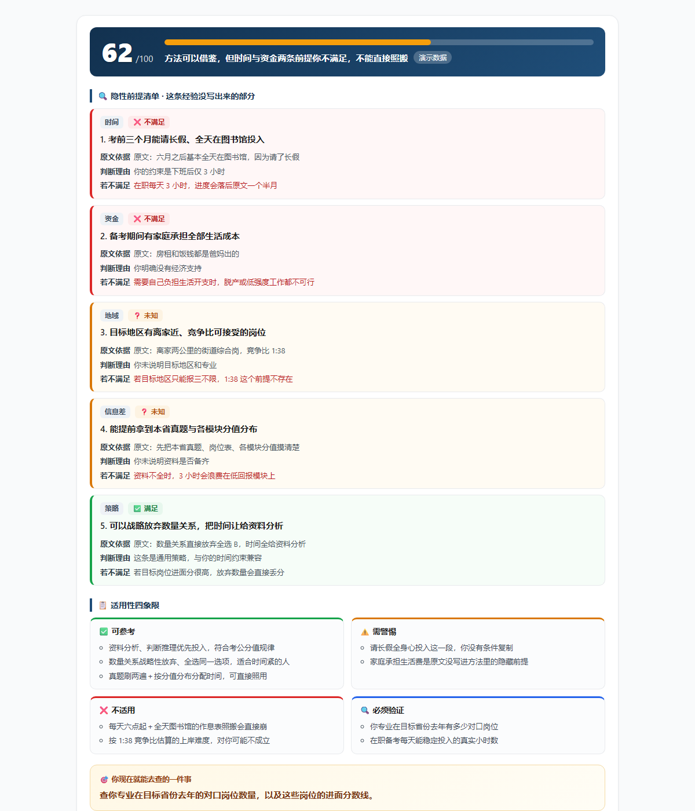
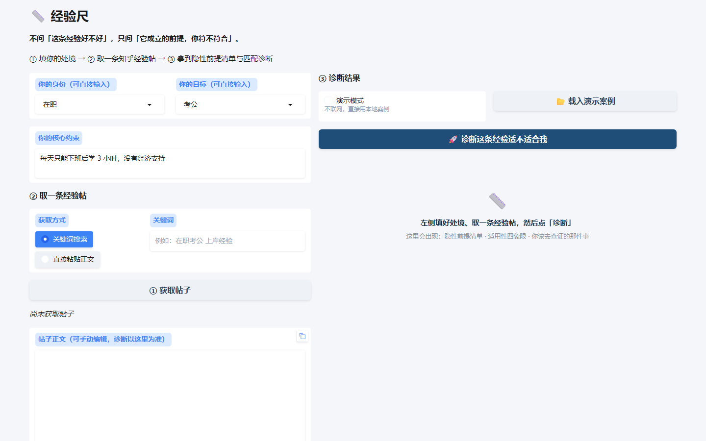

# 📏 经验尺 (Experience Ruler)

> **不帮你读得更快，只帮你判断得更准。**
>
> 知乎黑客松 S3 · 湾区共创季 ｜ 知识探索站赛道

### 🔗 在线体验：https://hilbertron-experience-ruler.ms.show

> 免费实例首次访问需等待约 30 秒冷启动。即使不配置密钥，勾选界面上的**「演示模式」**也能完整体验全流程。



---

## 💡 项目背景与痛点

知乎最独特的内容资产是**「个人经验」**（考公上岸、转行复盘、考研避坑等）。但这类内容有一个致命盲区：**写作者很少主动标注经验成立的前提条件。**

- 一条「全职备考半年上岸」的经验，隐含条件可能是：家里能提供半年无收入支持、本科专业有对口岗位。
- 对于「需要自己赚生活费、只能在职备考、专业只能报三不限」的用户，照搬这条经验**不仅无效，反而有害**。

现有的 AI 工具都在做「摘要、筛选、推荐」，但**没有一个工具在处理：这条经验到底适不适合「我」现在的处境？**

## 🚀 我们的解法

**「经验尺」** 是一个经验适用性诊断 Agent。它不提供标准答案，而是把决定权交还给用户，帮用户**「停下来校准」**。

1. **输入你的处境** —— 选择身份、目标，填写核心约束（如：在职、双非、缺钱）。
2. **取一条经验帖** —— 关键词一键抓取知乎相关帖子（可切换候选），或直接粘贴正文。
3. **生成诊断卡片** —— 大模型抽取帖子中「没写出来但决定它能否成立」的隐性前提，逐条比对你的处境：

| 区块 | 内容 |
|---|---|
| 🔍 **隐性前提清单** | 每条标注 `✅ 满足` / `❌ 不满足` / `❓ 未知`，附原文依据与判断理由 |
| ✅ **可参考** | 适合你的部分及原因 |
| ⚠️ **需警惕** | 部分适用的地方，在什么条件下会失效 |
| ❌ **不适用** | 照搬会出什么问题 |
| 🔍 **必须验证** | 你看完这篇帖子后，最该去查证的一个具体问题 |

## 🖥 界面

左侧填处境、取帖子，右侧出诊断卡片：



## 🛠 技术栈

| 层 | 选型 |
|---|---|
| 界面 | Gradio 6 |
| 数据源 | 知乎开放平台 API（`zhihu_search` 接口） |
| 大模型 | 任意 OpenAI 兼容接口（默认 DeepSeek，可切智谱 GLM-4-Flash 等免费模型） |
| 规则层 | `prompt.py` —— Prompt 与消息拼装 |
| 渲染层 | `ui_cards.py` —— 诊断卡片 HTML |
| 演示数据 | `fixtures/cases.json` —— 三个内置案例（考公 / 考研 / 转行） |

## 📁 项目结构

```
experience-ruler/
├── app.py              # 主程序：抓取、管线、界面
├── prompt.py           # 诊断规则（Prompt）
├── ui_cards.py         # 诊断卡片渲染
├── fixtures/cases.json # 演示案例
├── requirements.txt
└── .env.example        # 环境变量模板
```

## 💻 本地运行

### 1. 克隆仓库并切换分支

```bash
git clone https://github.com/0925Liyek/experience-ruler.git
cd experience-ruler
git checkout dev
```

### 2. 安装依赖并配置环境变量

```bash
pip install -r requirements.txt
```

在项目根目录新建 `.env` 文件（注意前面有个点），填入密钥：

```env
ZHIHU_ACCESS_SECRET=你的知乎开发者平台密钥
DEEPSEEK_API_KEY=你的 DeepSeek 密钥
```

> ⚠️ `.env` 已被 `.gitignore` 忽略，**千万不要提交到仓库**。

想换用其他大模型（任何 OpenAI 兼容接口）：

```env
LLM_BASE_URL=https://open.bigmodel.cn/api/paas/v4
LLM_MODEL=glm-4-flash
LLM_API_KEY=你的密钥
```

### 3. 启动

```bash
python app.py
# Windows 若 python 被商店别名拦截，用 py app.py
```

浏览器打开 `http://127.0.0.1:7860`。

## 🧭 边界

不判断这条经验对不对、作者好不好、内容真不真；只做一件事——**抽取隐性前提，对照你的处境，给出适用性判断**。

我们不提供答案，我们提供一次停下来校准的机会。
